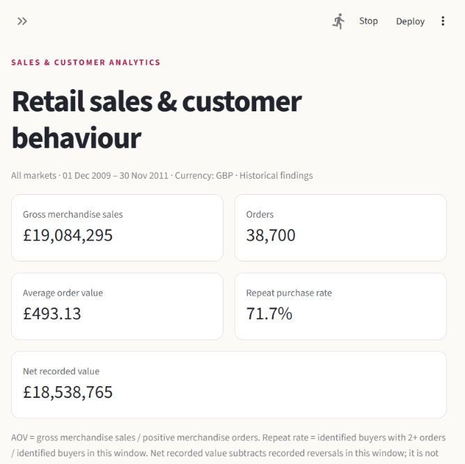
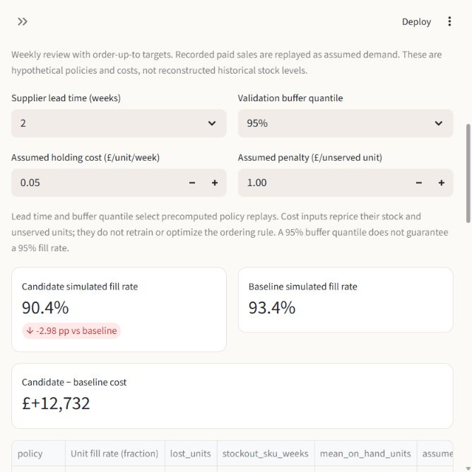

# Retail Operations Portfolio

Retail sales, customer analytics, demand forecasting and inventory decisions, built by **Shikhar Shrivastav** as a business operations portfolio. Two substantial projects share one audited public transaction warehouse.

**Project 1:** an interactive sales dashboard, seven SQL analyses, a reproducible data pipeline, audited metric definitions, and five historical business recommendations.

**Project 2:** training-only SKU selection, rolling-origin forecast evaluation against two baselines, frozen model selection, and 18 audited inventory policy/scenario replays. The candidate improves one-week WAPE from **55.11% to 52.00%** against the stronger baseline, but performs worse on inventory service and assumed cost. That negative operational finding is retained.

This uses public UK giftware sales. It does not contain Myntra data, fashion categories, live stock levels, or measured commercial impact.

## Run locally

Python 3.12 recommended. From this directory:

```powershell
python -m venv .venv
.\.venv\Scripts\python -m pip install -r requirements.txt
.\.venv\Scripts\python -m retail_ops.pipeline
.\.venv\Scripts\python -m retail_ops.build_forecasting
.\.venv\Scripts\python -m streamlit run app.py
```

On macOS/Linux, replace `.\.venv\Scripts\python` with `.venv/bin/python`.

The first pipeline downloads the original approximately 44 MB UCI workbook and reads both sheets. The first run can take several minutes; subsequent builds use a checksum-validated Parquet cache. The forecasting build then runs locally with NumPy, without external model services. Raw data and the SQLite database stay local. Download is an explicit pipeline action, not a dashboard side effect.

After setup on Windows, `./run.ps1` starts the app and builds the database if it is missing. Forecast results are committed, so the forecasting page can also be explored before rebuilding them.

## Explore Sales & customers

- **Sales overview:** market/date filters, gross sales, orders, AOV, repeat rate, monthly trading and a gross-to-net recorded value reconciliation.
- **Customers & cohorts:** identified-customer coverage, transparent behavioural segments and a fixed 90-day repeat-purchase measure.
- **Product performance:** searchable SKU results, concentration, recorded reversals and CSV exports.
- **Pricing & promotion evidence:** observed price variation and the precise data missing for a promotion-effectiveness claim.
- **Definitions & SQL:** source audit, metric contracts and the actual parameterized SQL used by every result.

The default window is **1 December 2009–30 November 2011**, covering complete months. The last nine observed days of December 2011 are available through the date filter and visibly flagged as a partial month.



## Explore Forecast & inventory

Use the sidebar navigation to open the second project:

- **Forecast evaluation:** actual versus predicted weekly units, validation search, untouched holdout metrics, horizon-specific errors, SKU failures, and downloadable forecasts.
- **Inventory scenarios:** lead time and safety-buffer controls, fill rate, unserved replay units, inventory levels, cost sensitivity, and the receive/order/fulfil ledger.
- **Study design & evidence:** chronological splits, training-only SKU selection, explicit equations, assumptions and the independent reconciliation.

The study selects 50 active UK SKUs using the first 60 complete weeks only. It uses 16 validation weeks, eight inventory warm-up weeks, and 20 held-out evaluation weeks. Inventory outcomes are simulations with hypothetical costs and no claim of actual stockout reduction.



## Review the work

| Evidence | Location |
|---|---|
| Business findings and proposed actions | [Business review](docs/business_review.md) |
| Numerators, denominators, exclusions and limitations | [Methodology](docs/methodology.md) |
| Interview explanation and questions | [Interview guide](docs/interview_guide.md) |
| Forecasting design, loss functions and inventory equations | [Forecasting methodology](docs/forecasting_methodology.md) |
| Forecast and inventory results, including the failed operational improvement | [Forecasting business review](docs/forecasting_review.md) |
| Second-project interview explanation | [Forecasting interview guide](docs/forecasting_interview_guide.md) |
| Actual SQL | [sql/](sql/) |
| Regenerated historical result tables | [reports/](reports/) |
| Data quality and source checksum | [reports/data_quality.json](reports/data_quality.json) |

## Validate

```powershell
.\.venv\Scripts\python -m pytest -q
.\.venv\Scripts\python -m retail_ops.validate
.\.venv\Scripts\python -m retail_ops.validate_forecasting
```

Checks cover hand-verifiable invoices, future-data leakage, training-only selection, baseline arithmetic, zero-demand error metrics, inventory timing/conservation, warm-up exclusion, and both dashboard pages. Full-data validators independently reconcile sales metrics, 5,200 weekly source cells, 53,000 saved forecast rows and 25,200 inventory ledger rows. GitHub Actions runs fixture and dashboard checks without downloading the full source.

## Data model

`data/raw/online_retail_II.xlsx` → normalized source cache → disposition and overlap audit → `sales`, `returns`, `orders` in `data/processed/retail.sqlite` → shared SQL → dashboard and historical CSVs.

`sales` and `returns` contain merchandise line items. `orders` aggregates positive merchandise lines to one row per invoice. Raw source row and sheet references survive in both line tables. Daily observed units by SKU and market feed project 2's complete-week panel. Its absent SKU-weeks are treated as no recorded paid sales, explicitly not proof of zero unconstrained demand.

## Source and attribution

Chen, D. (2012). **Online Retail II** [Dataset]. UCI Machine Learning Repository. [Dataset page](https://archive.ics.uci.edu/dataset/502/online+retail+ii). [DOI: 10.24432/C5CG6D](https://doi.org/10.24432/C5CG6D). Licensed under [CC BY 4.0](https://creativecommons.org/licenses/by/4.0/).

Transformations include normalized identifiers, proven cross-sheet invoice overlap removal, merchandise classification, integer monetary storage, and aggregated reporting. The accompanying software is MIT licensed. Historical patterns are not claims of future performance or business improvement.
